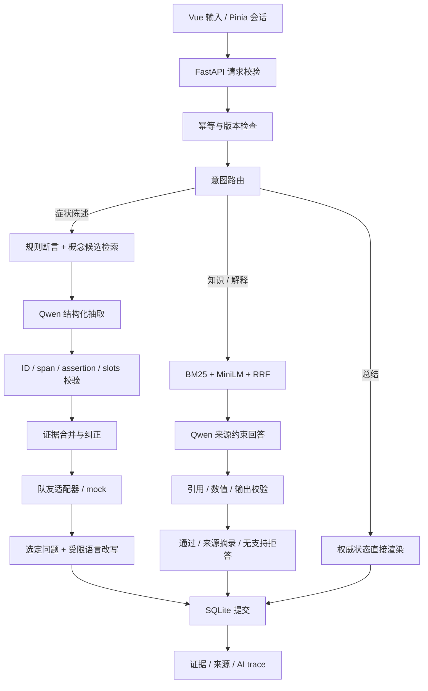

# AI 技术详解与求职材料（2026-09-15 升级版）

## 项目定位

建议项目名：**Symptom Guide — Contextual NLP & Grounded Dialogue Lab**。

定位为 AI Application Development / LLM Integration / Conversational AI 工程作品：把真实本地语言模型接入可维护的业务流程，围绕可追溯结构化数据、检索、生成校验、会话可靠性和实验评测形成完整交付。适合作为申请 Singapore AI Development Intern 的技术作品。这里讨论岗位能力映射，不代表某公司的当前招聘要求或录用概率。

个人职责是 NLP、chatbot 编排、后端、前端和这些模块的集成测试。队友的疾病召回、Informed Search 和医学知识图谱推理仍通过接口适配，默认使用 mock。你实现的**概念候选检索 / 文档检索**和队友的**疾病召回**是两个不同任务，面试时必须说清楚。自动化工具辅助编写了本次升级；简历使用“实现 / 负责模块”前，应完成下方源码讲解与独立修改练习，避免声称所有设计和代码均由本人独立完成。

## 能力变化

| 能力 | 原版 | 升级版实际实现 |
| --- | --- | --- |
| NLP | 别名、断言规则 | BM25 + MiniLM 概念候选、Qwen 上下文抽取、Schema / 原文 span 校验、规则优先融合 |
| 槽位 | 症状与肯否 | duration_text / severity_text；单实体精确文本投影补充模型遗漏 |
| 对话 | 结构化按钮与固定追问 | 报告、知识问答、解释、总结、范围边界五类路由；待回答问题作为上下文 |
| 检索增强 | 无文档问答 | 9 篇可追溯短文档，BM25 / dense / RRF 消融对照，top-3 引用来源 |
| LLM | 可选接口、无真实验证 | Qwen2.5-1.5B-Instruct 本机 CUDA 推理；真实 token / 延迟 / 回退可见 |
| 前端 | 会话与证据 | AI trace、来源卡片、检索排名、槽位与快捷知识问答 |
| 质量证据 | 规则和接口测试 | 增加真实模型固定样例、失败记录和真实 AI 浏览器测试 |

没有微调模型，没有做 DDXPlus 临床评测，没有云端生产上线，没有声称模型具备医学诊断能力。使用现成预训练权重完成推理集成与可靠性工程，本身可以成为 AI development 的技术内容。

## 调用链与模块划分

1. `backend/app/services/chatbot_service.py::_execute`：相同 request_id 的相同负载返回历史响应；不同负载拒绝。校验 expected_version，避免旧页面覆盖新状态。
2. `dialogue_ai.py::route`：轻量正则路由，**不是训练过的意图分类模型**。知识问题不会进入症状抽取。
3. 短省略回答先分类为 present / absent / uncertain / unrelated，再由程序绑定待回答 ID 与完整原文；明确停止和不确定模式优先，分歧写入 trace。其它文本使用 `context_nlp.py::analyze_context`：基线证据 + top-5 概念候选 + 当前待回答症状构成可选 ID 集。Qwen 只能建议该集合内的实体。
4. `model_runtime.py::LocalGenerator.generate`：同一模型实例，chat template、greedy decoding、token 上限与互斥锁。本地加载，不执行远程自定义代码。长于 2048 token 的输入预算失败后回退，不静默截掉用户内容。
5. Schema 校验之后验证唯一原文引文、合法断言和槽位子串；排除规则已识别的家庭 / 历史症状；显式规则断言优先，分歧写入 warnings。
6. `slot_extraction.py::project_slots`：只有一个当前阳性实体且只有一个匹配槽位时做精确文本投影；多实体归属歧义交给模型，不用一个持续时间覆盖所有实体。
7. `dialogue_ai.py::conversational`：把检索来源与必要问题上下文放入 prompt，生成 answer + citations。校验失败直接使用检索原文，有支持才回答。
8. `frontend/src/components/AITrace.vue`：显示最近一次请求的执行路径。详细 trace 也保存在会话响应和导出 JSON；当前没有每轮完整 trace 的独立审计表。

## NLP 为什么要混合

规则在明确词语、否定和家族史上可预测，却无法覆盖任意转述。MiniLM 用句向量帮助找可能的症状概念，Qwen 在候选和问题上下文内给出断言和原文证据。检索只提出候选，不能把相似度当症状确认，也不能称其为实体识别准确率。

例如 `I cannot catch my breath.` 没有命中旧别名，模型仍可在候选范围内归到 shortness of breath。`That has stopped completely.` 必须知道当前问的是哪个症状，才能形成 absent 证据。独立的无上下文规则基线不具备这个能力，因此对照结果同时反映了模型推理和上下文输入的收益，不是纯模型大小实验。

duration / severity 保留用户原文，不强行换算成医学标准值。`for three days` 提取 `three days`；`since yesterday` 保留原句。没有实现多语言时间归一化、数值温度实体、实体链接训练或 SNOMED / UMLS 的医学等价映射。

**格式校验不等于语义校验。** 合法 ID + 真正存在的 quote 仍可能被模型错误关联。例如调试探针里“感觉快要吐了”被归为已发生 vomiting，是目前可讨论的语义弱点。默认 confidence=1.0 是遗留字段，不能解释为模型校准概率。

## 检索与 RAG

知识库包含三个 NHS 页面摘要与六个项目行为说明，每条都带稳定 ID、title、text、URL、kind、reviewed_at。它们已经是短段落，所以当前没有长 PDF 切块管线。版本通过文档内容 SHA-256 指纹标识；修改知识 JSON 后重启服务重建内存索引。

BM25 使用词项频率、逆文档频率和长度归一化，参数 k1=1.5、b=0.75，过滤简单英文停用词。MiniLM 生成归一化句向量，点积等于余弦相似度。RRF 得分为各路 `1 / (60 + rank)` 之和，rank 从 1 开始。只有 BM25>0、或 dense cosine>=0.30 的文档进入各路排名；零分文档不获得融合投票。阈值 0.30 是启发式门槛，未经概率校准。

为什么不直接向量库？只有 9 个短文档和 10 个症状，NumPy 内存索引更容易验证和部署。向量数据库在文档规模、过滤条件和更新需求增加时才值得引入。当前没有声称使用 FAISS、Milvus、Pinecone、LangChain 或 LangGraph。

RAG 返回合法来源 ID 并检查数字来自所引文档，同时拒绝部分个体诊断 / 剂量 / 临床用途表述。**这不是完整的文本蕴含或事实核验器，也不是已证明能抵御所有 prompt injection 的安全方案。** 实测解释问题曾产生“用于进一步诊断”的不当目的陈述，最终版本拒绝这条生成并显示真实项目说明。对其它改写仍需人工检查语义支持。

追问由适配器决定目标，LLM 只能改写中性问句。最终还要通过有限语法检查，防止添加别的症状、改变为否定引导问句或夹带建议；不通过就保留模板。它是受控编排，不是无限循环的自主 agent 或工具自主规划。

## 真实评测与如何阅读

完整数字以 `evaluation/ai_report.json` 为准。数据是人工编写的英文工程样例，后续缺陷修复使用过该集合，因此属于**开发回归集，不是 held-out test set**。调试探针另外保存于 `scripts/probe_local_ai.py`。初次 1.5B 报告保留在 ai_report_initial.json，便于展示失败发现与修复过程。

| 指标 | 规则 / 单路基线 | 最终混合方案 |
| --- | --- | --- |
| 24 条 NLU：实体+断言 micro-F1 | 0.6286 | 0.9091 |
| 同组 exact match | 0.4583 | 0.8333 |
| 9 条检索 Recall@3 | BM25 7/9；dense 7/9 | RRF 8/9 |
| 检索 MRR@3 | BM25 0.6667；dense 0.7222 | RRF 0.8333 |
| 7 个标注槽位精确匹配 | 初次模型方案 2/7 | 加保守投影后 7/7 |

24 条中，模型输出通过校验 16 条、回退 7 条、无候选跳过 1 条。**16/23 是调用校验通过率，不是抽取准确率。** F1 是最终混合系统输出，包含规则兜底。6 个对话样例中，4 个使用通过校验的 LLM 回答，1 个使用来源摘录回退，1 个无支持拒答；不能写成“6/6 生成正确”。NLU 中位耗时约 1.81 秒，来自这一次本机顺序运行，含候选检索与校验、不含冷启动和 Web 队列；不是线上 SLA，也不是吞吐测试。

micro-F1 将 `(concept_id, assertion)` 看作集合元素，错误状态会同时产生 FP 和 FN。每条全对才算 exact match。Recall@3 是正确文档是否进入前三；MRR@3 还考虑它出现的位置。这比只展示成功截图更容易解释技术取舍。

失败仍在报告中：`My head is pounding.`、`My throat is really sore.` 回退后无证据；`The room feels like it is spinning.` 没有可用候选。攻击样例直接调用 NLP 时还会把指令中的 fever 误作证据，因此 NLU 单独暴露是不合适的；API 前面的范围路由会拦截该样例，测试验证证据不变化。路由仅覆盖已写规则，不保证所有攻击变体。

## 工程可靠性与边界

- 队友缺席：mock 只模拟候选、顺序与接口，不模拟 LLM。AI_PROFILE=local + REASONING_MODE=mock 是**真实 AI 推理 + 模拟疾病算法接口**。
- 状态一致性：消息、证据与幂等响应在一个 SQLite 事务内提交；版本冲突拒绝旧请求。知识与总结也增加消息版本，但不增加症状追问 round。
- 异常：运行中模型输出异常回退可见；模型文件缺失时服务初始化失败，需恢复文件或显式选择 offline，不伪装为已加载 LLM。
- 性能：当前模型锁 + SQLite 写事务适合单用户演示，长推理会阻塞其他写操作。生产化应把推理移到可取消任务，提交时重新校验版本，加入队列 / 限流 / 超时与资源隔离。
- 数据：SQLite 存原文、证据、版本和最新 trace，不加密；session_id 是访问凭据，没有账户授权层。仅本机、虚构输入，不宣称满足任何医疗合规认证。
- UI：完整支持证据纠正、历史、持久化恢复、JSON 导出、来源与延迟。Vite 构建存在约 1.09 MB 主 JS 包的体积提醒，尚未做首屏性能优化。

## 简历候选表述

下面是工程交付候选文字。教育、学位、GPA、实习起止时间和新加坡工作资格未提供，不做推断。是否能自称独立设计，应以你实际掌握和参与为准。

**四个架构支柱：上下文理解、检索与生成、可靠编排、评测与可观测性。**

- **上下文理解：** 将症状别名匹配扩展为规则、MiniLM 概念候选与本地 Qwen 结构化抽取的混合流程，加入原文 span、断言与槽位校验，在 24 条自建开发回归样例上将实体—断言 micro-F1 从 0.629 提升到 0.909，保留失败和回退证据。
- **检索与生成：** 实现 BM25、dense embedding 与 RRF 的来源检索，接入受来源约束的 LLM 问答及引用校验，在 9 条工程问题上获得 8/9 的 Recall@3；无支持或生成校验失败时分别拒答或返回来源摘录。
- **可靠编排：** 通过 FastAPI、SQLite 与 Vue/Pinia 实现多轮会话、幂等重试、版本冲突检查和证据纠正，将知识问答与症状状态更新分开，并以可替换 mock/HTTP 适配器独立验证团队接口。
- **评测与观测：** 构建规则与真实本地模型的回归评测、检索消融及浏览器验收，展示模型 token、GPU 延迟、检索排名和回退路径，以可复现报告支持 AI 集成效果分析。

英文简历建议选 2–3 条，不必四条都塞进简历：

- Implemented a contextual NLP pipeline combining rule-based assertions, MiniLM concept retrieval and local Qwen inference, with schema and source-span validation; improved entity–assertion micro-F1 from 0.629 to 0.909 on 24 self-authored development cases.
- Built source-grounded chatbot Q&A using BM25/dense retrieval and reciprocal rank fusion, achieving Recall@3 of 8/9 on a small engineering evaluation set, with explicit citation checks, abstention and extractive fallback.
- Integrated the AI pipeline into a FastAPI/Vue application with persistent dialogue state, idempotent mutations, evidence correction and model execution traces; tested independently through mock adapters for teammate-owned reasoning modules.

简历顶部摘要候选：

> AI development internship candidate with a working NLP/LLM application prototype, combining local model inference, retrieval evaluation and reliable full-stack integration. Seeking to contribute to applied AI development and model-to-product integration in Singapore.

英文 HR 短开场白：

> Hi, I’m interested in your AI Development Internship. My recent GC1 project integrates local Qwen inference, contextual NLP and source-grounded Q&A into a FastAPI/Vue application. I can share the working demo and reproducible evaluation results, including limitations and fallback cases.

稍完整自我介绍：

> In my GC1 team project, my scope covers NLP, chatbot orchestration and the frontend/backend integration. I extended an initial rule-based demo with local Qwen inference and MiniLM retrieval, and added validation, persistent dialogue state and a reproducible evaluation suite. I focus on making model behaviour observable and testable, including failures, rather than presenting only successful outputs. The disease retrieval and informed-search modules belong to teammates and are represented by adapters in my standalone demo.

## 求职展示与源码自查

建议先掌握 `context_nlp.py`、`retrieval_service.py`、`dialogue_ai.py` 的输入输出，再解释 `chatbot_service.py` 的事务与版本控制，最后演示 `AITrace.vue`。你应该能独立完成：增加一条有来源的知识文档并检查检索变化；新增一条否定样例；故意让模型输出不存在的 ID 并解释回退；说明为什么 unknown 不等于 absent；在不改前端的情况下替换一个队友适配器。

可稳妥投递定位：AI Application / LLM Integration Intern。更偏研究的 NLP / ML Research Intern 定位仍缺少训练实验、外部独立标注集和泛化验证。更偏生产 ML Platform 的岗位仍需要部署、认证、并发压测与可观测平台证据。这里不把后续计划写成已完成成果。

## 第一手资料

- [Qwen 1.5B 模型卡、许可证与加载示例](https://huggingface.co/Qwen/Qwen2.5-1.5B-Instruct)
- [MiniLM 模型卡](https://huggingface.co/sentence-transformers/all-MiniLM-L6-v2)
- [Sentence Transformers 相似度计算](https://www.sbert.net/docs/sentence_transformer/usage/semantic_textual_similarity.html)
- [PyTorch 历史版本安装命令](https://pytorch.org/get-started/previous-versions/)
- [NHS 发热说明](https://www.nhs.uk/symptoms/fever-in-adults/)、[咳嗽说明](https://www.nhs.uk/symptoms/cough/)、[呼吸困难说明](https://www.nhs.uk/symptoms/shortness-of-breath/)

