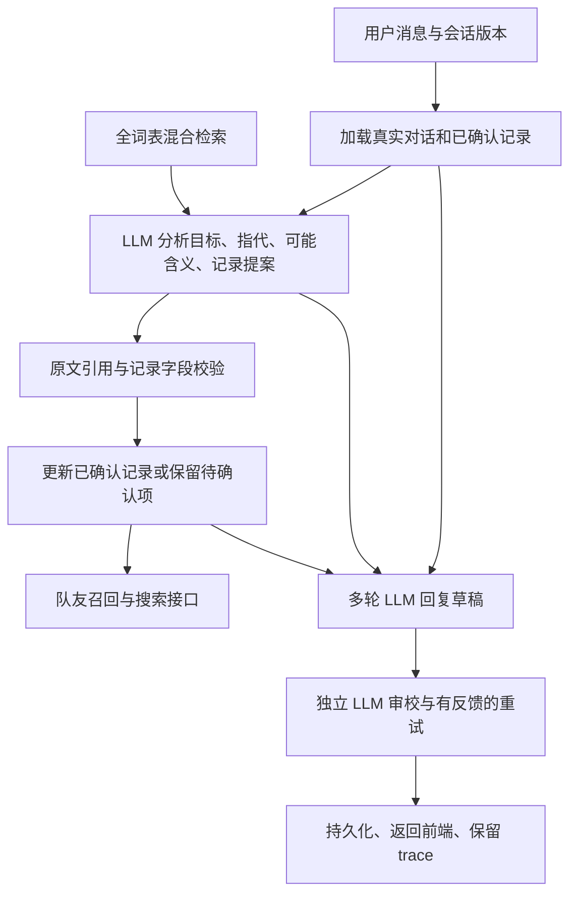

# NLP 与多轮 LLM 对话重构记录（v8）

本次针对“固定意图分类不能理解真实对话”的反馈重构默认 local 聊天路径。交付重点是开放式语言理解、多轮上下文、可验证的状态更新，以及真实本地模型验收。它仍是英文症状记录与知识交流的课程原型，不应表述为医疗诊断系统。

**交付状态：架构和工程已实现，定向自动检查通过；自由对话语义质量尚未全部达标。** 当前仍会出现重复引导和知识回答中的额外追问，具体记录见 `evaluation/conversation-agent-human-review.md`。

## 为什么需要重构

旧版本先把输入分到预设 intent，再选择模板或局部 LLM 回答。即使增加 guide、repair 等标签，用户说 “What?”、连续回答 “yes”、更换话题时，仍容易落回同一个澄清菜单。旧模型还会把回复写成对用户行为的旁白。分类准确率或接口成功率不能衡量这些问题。

v8 local 模式不调用旧 classify / conversational 分发。旧实现保留在 `DIALOGUE_ENGINE=legacy`，用于对照与历史回归；`AI_PROFILE=offline` 仍是无模型测试配置。

## 当前调用链

1. FastAPI 接收消息，校验 session version 和 request_id，加载 SQLite 会话。
2. ConversationAgent 让 LLM 用自然语言描述 `user_goal`、`reference_resolution`、`unresolved`，并为歧义表达生成 `possible_meanings`。这些字段没有意图枚举，不用于选择固定回复模板；可能含义来自当轮模型分析，用于生成有针对性的澄清。
3. BM25 + MiniLM + RRF 从全部 15,135 个症状节点检索概念候选；精确词匹配补充候选。检索是概念对齐工具，不负责决定用户想聊什么。分析提示明确区分“可写入记录的候选 ID”和“用户话语的可能含义”，避免候选词表定义聊天话题。
4. LLM 提出可选 observations，包括概念 ID、用户本轮原文引用和 present/absent/uncertain。这里只约束数据库写入动作，不能把三个状态误称为用户意图分类。
5. 验证器检查候选 ID、原文定位、他人/历史排除、问句保护及隐含回答的实际前文。不能确认的语义映射进入 pending_evidence，不直接调用队友推理模块。
6. 有验证通过的证据才合并记录、调用召回和 Informed Search 接口。默认 random 是独立集成测试数据，不能当成诊断质量。
7. 回答模型接收真正的 user/assistant 消息列表，以及已保存记录、未确认语义、应用控件事实、检索知识片段。所有自然语言聊天消息都走多轮 LLM，包括解释、描述协助、修复误解、话题切换、范围外请求。
8. 独立的 LLM 回复审校读取同一真实对话、已保存记录和草稿，重写可能存在的角色混淆、重复追问、虚构记录/控件和范围偏离。审校不修改证据，不分派用户意图标签，也不保证每条回答正确。
9. 保存最终回复、证据和 trace；前端展示记录及可检查的模型运行信息。

关键代码：`backend/app/services/conversation_agent.py`、`model_runtime.py`、`chatbot_service.py`、`backend/app/models/chat_models.py`、`frontend/src/stores/chat.ts`。



## 上下文与故障处理

回答保留最近 16 条消息，去掉开头孤立的 assistant 消息；超出 4,096 输入 token 时丢弃最旧完整轮次，保留 system 和当前用户输入。结构化分析使用最近 7 条消息，每条最多 500 字符。已确认记录独立保存在会话中，不随聊天窗口裁剪而消失。自然语言 working_interpretation 只是提示，用户原话和更正优先。

这不是无限记忆，也没有向量化长期会话记忆。长对话中的非症状细节可能丢失；本轮消息本身或打包后的审校输入超过预算会明确失败。每轮通常包含理解、草稿、审校三次本地生成；格式修复或不合格回复重试会额外调用。审校提高成本和耗时，当前不是低延迟流式服务。

结构化理解使用贪心生成；对话与审校使用官方建议的 temperature=0.7、top_p=0.8、top_k=20。`LOCAL_GENERATION_SEED` 默认 20260916，每次生成设置该种子以便回归对照；这不保证不同 GPU/库版本间逐字一致。重试会把具体修订反馈传给审校模型，避免用相同输入再次生成相同回复。

可选描述字段兼容空数组或 null；动作字段继续严格验证。格式错误最多让模型修复一次，再次失败则不写入证据，聊天仍可继续。trace 区分分析、修复、生成，记录模型、量化方式、token 数、耗时和被丢弃消息数。此机制避免将解析失败伪装成症状成功提取。

前端自由对话不再显示与实际回复无关的随机症状 Yes/No 按钮。待确认语义在侧栏单独展示；刷新后保留会话。已记录症状仍可用下拉框更正。

## 模型与本机配置

新默认 local 模型为官方 [Qwen3-4B-Instruct-2507](https://huggingface.co/Qwen/Qwen3-4B-Instruct-2507)，固定 revision `cdbee75f17c01a7cc42f958dc650907174af0554`。下载回执在模型目录 `download-receipt.json`。使用本机 RTX 3060 Laptop 6GB，NF4 double quantization，FP16 计算；没有训练或微调权重。

新增依赖固定为 bitsandbytes 0.48.1、accelerate 1.10.1，见 `backend/requirements-agent.txt`。量化运行环境要求见 [bitsandbytes 官方说明](https://huggingface.co/docs/bitsandbytes/v0.48.1/en/installation)。模型只从本地加载，`trust_remote_code=False`。

曾尝试下载 Qwen2.5-7B-Instruct 做对照，固定 revision 为 `a09a35458c702b33eeacc393d103063234e8bc28`；当前传输速度不足，权重未完整下载、未做推理验收。其部分下载文件不属于可运行交付，不应在启动命令中选择该目录。默认仍使用完整下载的 4B 模型。

手动配置和启动（PowerShell）：

```powershell
conda activate gc1
cd E:\Study\StudyAtNUS\GC1_Project
python -m pip install -r backend/requirements-agent.txt
# 当前机器已下载；换电脑或缺文件才执行这一条
$env:HF_HUB_DISABLE_XET='1'
$env:HF_HUB_OFFLINE='0'
python scripts/download_agent_model.py --root E:\Study\StudyAtNUS\GC1_Project

$env:AI_PROFILE='local'
$env:DIALOGUE_ENGINE='agent'
$env:LOCAL_MODEL_PATH='E:\Study\StudyAtNUS\GC1_Project\models\Qwen3-4B-Instruct-2507'
$env:LOCAL_MODEL_4BIT='true'
$env:EMBEDDING_MODEL_PATH='E:\Study\StudyAtNUS\GC1_Project\models\all-MiniLM-L6-v2'
$env:NLP_ENGINE='rules'
$env:NLP_USE_TRANSFORMERS='false'
$env:REASONING_MODE='random'
$env:HF_HUB_OFFLINE='1'
python -m uvicorn app.main:app --app-dir backend --host 127.0.0.1 --port 8000 --no-access-log
```

`NLP_ENGINE=rules` 在新路径只表示保留词表匹配/写入校验基础组件，不表示用规则生成聊天回复。首次请求需加载模型和完整概念索引。只启动一个 GPU 服务；CPU 模式需 `LOCAL_MODEL_4BIT=false` 且需足够内存，未在此次交付中做 CPU 性能验收。

前端源码修改后：

```powershell
cd E:\Study\StudyAtNUS\GC1_Project\frontend
npm ci
npm run build
```

## 验证方法与结果边界

```powershell
cd E:\Study\StudyAtNUS\GC1_Project
python -m pytest backend/tests -q
cd frontend
$env:TEST_BASE_URL='http://127.0.0.1:8000'
node test-agent.cjs
node review-agent.cjs
node browser-agent.cjs
```

实际结果见 `evaluation/conversation-agent.json`、`evaluation/browser-agent.json` 和本记录末尾的验收补记。机械检查与回答内容审阅分别记录，不把通过率等同于通用意图理解准确率。

保留失败证据：`conversation-agent-1.5b.json` 是旧小模型在新架构上的失败；`conversation-agent-4b-first-pass.json` 是首次 4B 测试，暴露 JSON 不稳定、记录未更新、回复过长和虚构 Edit 控件。`conversation-agent-4b-second-pass.json` 和 `conversation-agent-before-review.json` 记录进一步调整后的输出，其中机械检查通过仍存在重复追问或未标注的示例。保留这些报告是为了说明模型升级本身不能替代工程验证。

全词表仍可检索，旧版 75,675 个规则覆盖用例不等于 v8 对所有节点完成了 LLM 语义验收。本次真实连续对话是针对性测试集，不能宣传为“全量 LLM 理解准确率 100%”。

## 明确的限制与下一步评估

- 写入保护仍保守：含问号或以知识询问开头的混合消息可能只回答而不自动记录；请明确陈述症状或使用记录更正控件。
- 本地 4B 模型仍可能误解、啰嗦或产生不准确解释；知识片段没有覆盖全部症状。没有检索证据的回答来自模型知识，没有验证引用。
- 隐含 yes/no 的写入需要上一条真实回复明确提及相关症状；不能把随机 adapter 候选当成用户已经回答的问题。
- 记录更新有审计和版本控制，但并非具备临床验证的医疗 NLP。队友算法接口与本模块对话能力应分别验收。
- 后续应收集脱敏或虚构的未见对话，按指代、否定、更正、他人症状、混合请求、范围切换、长上下文分别评估。模型更换或提示词更改后重新运行，不沿用旧结论。

## 可用于技术面试的真实定位

可描述为“将固定意图路由重构为本地多轮 LLM 对话管线，实现开放式目标描述、全词表混合检索、受校验的症状状态更新、持久化会话和前后端可观测性，并用连续对话回归暴露和修复模型与状态不一致问题”。

个人贡献是 NLP/LLM 集成、对话状态与验证、FastAPI/Vue 工程和评估；不是训练基础模型，也不是实现队友的疾病召回或 Informed Search 算法。简历应引用最终回执中的实际测试数量和设备性能，不能引用模型官方 benchmark 当作个人项目指标。

## 最终验收补记

2026-09-16 在本机 gc1 Python 3.11 环境完成：

| 检查 | 结果 | 适用范围 |
|---|---|---|
| 后端 pytest | 145 passed，2 条弃用警告 | 包含既有离线回归和新增上下文/记录保护测试，不是 145 次真实 LLM 测试 |
| Vue/TypeScript/Vite | 构建通过 | 保留现有 bundle size 警告 |
| 连续对话 | 4 组场景、16 轮，机械检查通过 | 真实 Qwen3-4B NF4 推理，原始回答和 trace 均保存 |
| 定向行为规则 | 9 项自动检查通过 | 规则只覆盖明确可测的表面条件，不表示通用理解准确率 |
| Chrome 浏览器 | 通过 | 真模型回复、症状指代、无无关 Yes 按钮、刷新恢复、无页面 JS 错误 |
| 内容审阅 | 仍需改进 | 重复引导、额外追问、解释过度简化等，见独立审阅记录 |

16 轮中，各轮所有生成调用耗时之和的中位数约 **19.8 秒**，最小约 12.1 秒，最大约 78.4 秒；不含冷启动、检索、排队和 HTTP 开销。不能将其描述为低延迟实时聊天。模型与审校的调用明细保存在 JSON 中。

原始对话报告 SHA-256：`CCD8F248EAD945DA1E052E335B93033DFBFDB9BCCC19C4C3111256919DC51F50`。以后重跑测试会覆盖当前报告，应将新报告与新版本一并留档。

升级后建议使用新会话测试，避免旧版模板回复留在历史中影响模型；需要保存旧记录时，可先 Export session。原 SQLite 数据库不做清空或迁移删除。
